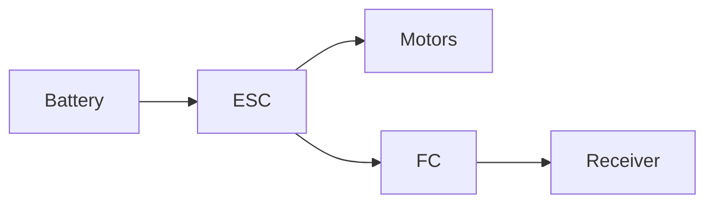

# KidCe FPV

A personal FPV website with articles, a wiki and a racing profile. The site is built with [MkDocs Material](https://squidfunk.github.io/mkdocs-material/) and automatically published to GitHub Pages on every push to `main` or `master`.

## Live wiki and dev preview

One GitHub Pages site serves two builds (`.github/workflows/deploy.yml`):

| Branch | URL | When it updates |
| --- | --- | --- |
| `main` | https://kidce.github.io/ | Only after the maintainer approves ("wiki push ok"): merge `dev` into `main` |
| `dev` | https://kidce.github.io/dev/ | On every push to `dev`, no approval needed |

Work in progress (wiki pages, GateLink simulator, Tinywhoop gate explorer/viewers) is pushed to `dev`
and is online at `/dev/` about a minute later. The preview shows a "DEV preview" banner and is
marked `noindex`. Its GateLink simulator is built from GateLink `dev` (or `main` while there is none).
Every run rebuilds both branches from their current heads, so a push to one never changes the other.
A failing dev build keeps the previous preview and never blocks the live wiki.

Promote the approved state: `git checkout main && git merge --ff-only origin/dev && git push`
(or merge only the approved commits). Afterwards bring `dev` up to date with `main` again.

## AI assistance disclosure

This project was updated with substantial assistance from OpenAI Codex. The repository maintainer directed the work, made the project decisions, and is responsible for reviewing and using the result.

## Run locally

```powershell
python -m venv venv
./venv/Scripts/Activate.ps1
pip install -r requirements.txt
mkdocs serve
```

The site will be available at `http://127.0.0.1:8000/`.

## Managing content

### Write a blog post

Create a Markdown file under `docs/articles/posts/`:

```markdown
---
date: 2026-07-14
categories:
  - Racing
authors:
  - kidce
---

# Article title

This short introduction appears in the article overview.

<!-- more -->

The full article continues here.
```

### Create a wiki page

Add the file to a suitable folder under `docs/wiki/`, then add it to the navigation in `mkdocs.yml`.

### Use images

#### Drag-and-drop tool

For the easiest workflow, start the local media tool from the repository root:

```powershell
./medien-tool.ps1
```

It opens in the browser. Select the target page, drag in one or more image, video
or audio files, and copy the generated embed code. Files are given safe names and
stored below `docs/assets/media/` in a folder matching the selected page. Existing
files are never overwritten. The gallery below the upload area shows all existing
media from `docs/assets/`, including the pages where each file is used. Search by
filename, path or page. To replace a file without breaking existing links, drag a
new file onto its gallery card and confirm the replacement. PNG and SVG images can
be exchanged directly; the tool renames the file and updates references in
Markdown, stylesheets and `mkdocs.yml` automatically.
SVG files also have a color editor in the gallery. It can replace individual
colors with a color picker or invert all detected SVG colors at once.
Each gallery card also provides an editor for its filename and description.
Renaming updates known references automatically; descriptions are searchable and
are applied as alt text to matching Markdown image references.
Media can be deleted from its gallery card. Files without references are removed
after one confirmation. Referenced files show every detected usage and require a
second explicit confirmation before deletion.

#### Manual workflow

Images are stored centrally and organized by section:

- `docs/assets/images/articles/`
- `docs/assets/images/builds/`
- `docs/assets/images/wiki/`

Embed an image in any Markdown file like this:

```markdown

```

The number of `../` segments depends on the depth of the Markdown file. The example above is correct for posts under `docs/articles/posts/`. You can also add a caption and fixed width:

```html
<figure markdown="span">
  { width="720" loading="lazy" }
  <figcaption>My setup at the first outdoor race.</figcaption>
</figure>
```

Before committing photos, consider converting them to WebP or JPEG and resizing them to about 1600 px wide.

Images embedded in Markdown automatically open in a touch-friendly lightbox. Add
`{ .no-lightbox }` to an image if it should not be enlarged.

### Add a diagram

Mermaid diagrams can be written directly in Markdown:

````markdown

````

### Feeds and sharing

The production build generates social preview cards for every page and RSS/JSON
feeds for posts below `docs/articles/posts/`. Social cards are generated in
GitHub Actions; they are disabled during local previews to keep startup fast.

## Enable GitHub Pages

In the repository, open **Settings → Pages → Build and deployment** once. Select **Deploy from a branch**, then choose the `gh-pages` branch and `/(root)`. The workflow creates and updates this branch automatically.
