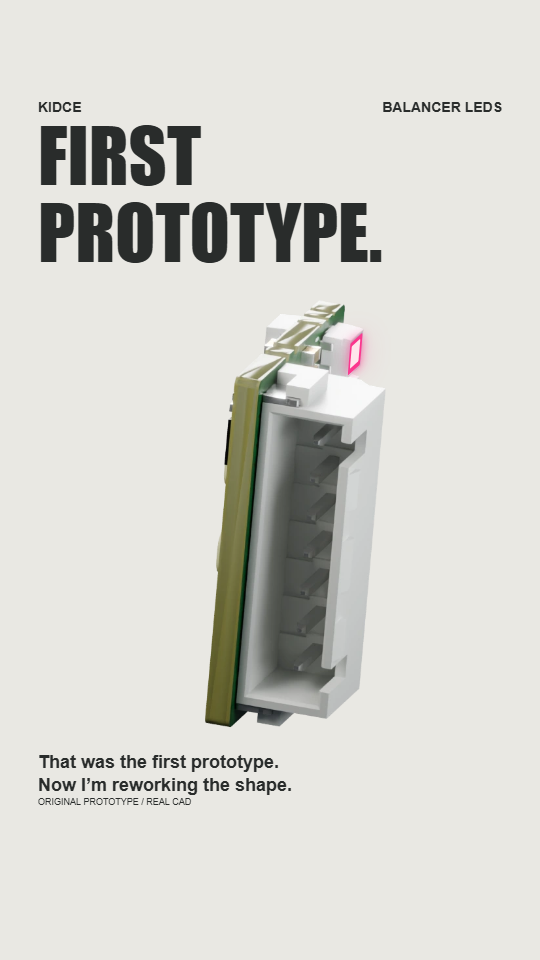
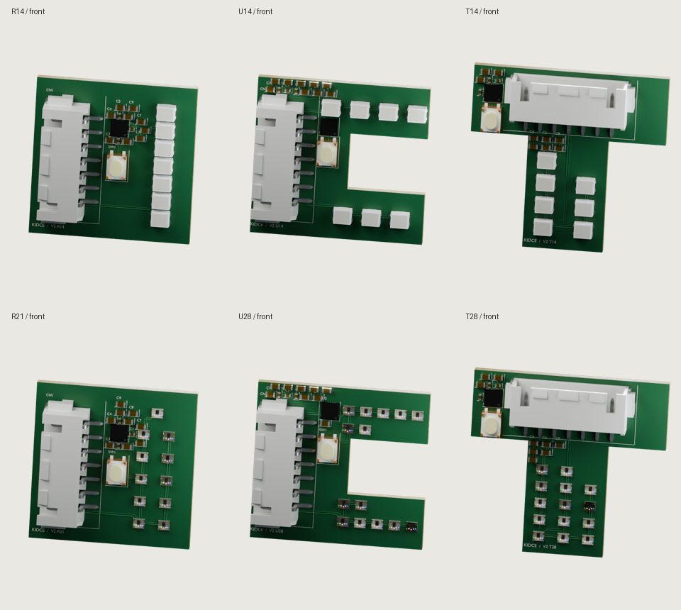

# Balancer LED V2 render review

Review snapshot: 7 November 2026 · SMR4 · connected transitions, detailed layouts and restrained LED glow.

The eighteen-second animation starts with the first prototype, turning along its long axis with a slight changing tilt. It then glitches through possible PCB shapes and LED layouts. The ending asks for mounting ideas for the next version.

## Latest animation

The prototype turns for five seconds, then blends into the first concept through a 1.8-second glitch transition. Each medium-ending layout stays visible for about 1.4 seconds, followed by a settled invitation for mounting ideas. The title changes in stages during the handover.

<video controls playsinline preload="metadata" poster="../../assets/media/projects/addressable-balancer-leds/reviews/2026-11-07/latest-poster.png" style="display:block;width:100%;max-width:430px;max-height:75vh;margin:1rem auto;background:#e9e8e3">
  <source src="../../assets/media/projects/addressable-balancer-leds/reviews/2026-11-07/continuous-occluded.mp4" type="video/mp4">
  <a href="../../assets/media/projects/addressable-balancer-leds/reviews/2026-11-07/continuous-occluded.mp4">Download the latest animation</a>
</video>

[Open / download latest MP4](../assets/media/projects/addressable-balancer-leds/reviews/2026-11-07/continuous-occluded.mp4){ .md-button .md-button--primary }

1080 × 1920 · 18 seconds · H.264 MP4. This is a review render, with illustrative lighting rather than measured brightness.

The bloom is reduced. CAD-rendered visibility masks suppress LEDs hidden behind the balance connector, and a foreground mask keeps the light layer off the connector and other components. This fixes the side-on view where the previous overlay shone through the connector.

## Interactive review

[Open the interactive review](../assets/media/projects/addressable-balancer-leds/reviews/2026-11-07/interactive-review.html){ .md-button }

The self-contained HTML includes subtle, medium and many-realities endings, sixteen newly rendered form studies with front/back views, editable text, KEEP / REWORK / PASS ratings and notes. Open it full-screen on your phone, or download it for offline review. Use **Save HTML with notes** or **Export notes / JSON** to return your choices. Browser-local notes do not sync between devices automatically. Only the current medium ending has an embedded MP4 download; all three endings play in the interactive canvas previews.

## Earlier lighting versions

The earlier ten-second versions use the same neutral background and medium ending. They are retained for comparison; SMR4 also changes the timing and PCB detail.

| Version | Video |
| --- | --- |
| Neutral baseline | [Open MP4](../assets/media/projects/addressable-balancer-leds/reviews/2026-11-06/neutral-baseline.mp4) |
| Strong LED glow | [Open MP4](../assets/media/projects/addressable-balancer-leds/reviews/2026-11-06/previous-glow.mp4) |
| Previous maximum bloom (superseded) | [Open MP4](../assets/media/projects/addressable-balancer-leds/reviews/2026-11-06/latest-bloom-max.mp4) |
| SMR4 connected sequence, current | [Open MP4](../assets/media/projects/addressable-balancer-leds/reviews/2026-11-07/continuous-occluded.mp4) |

## PCB form studies

The sixteen layouts span square, U, T, L, pill, round, chamfered and wide outlines. The original prototype has 14 LEDs, mirrored 7 + 7. Smaller TCWIN C48982518 studies show 21 LEDs total (11 + 10) or 28 total (14 + 14). One original button, the controller, balance connector and all 18 passive components are retained. The controller, button and most passives now sit on the front face rather than being hidden behind the board. Silkscreen designators and illustrative conductor paths add board detail. These paths are render artwork, not verified electrical routing.

These examples show the front only. The table links to both faces of every rendered study.

| Study | Shape | Total LEDs | Front | Back |
| --- | --- | --- | --- | --- |
| R14 | square | 14 (7 + 7) | [Image](../assets/media/projects/addressable-balancer-leds/reviews/2026-11-07/R14-front.png) | [Image](../assets/media/projects/addressable-balancer-leds/reviews/2026-11-07/R14-back.png) |
| U14 | U | 14 (7 + 7) | [Image](../assets/media/projects/addressable-balancer-leds/reviews/2026-11-07/U14-front.png) | [Image](../assets/media/projects/addressable-balancer-leds/reviews/2026-11-07/U14-back.png) |
| T14 | T | 14 (7 + 7) | [Image](../assets/media/projects/addressable-balancer-leds/reviews/2026-11-07/T14-front.png) | [Image](../assets/media/projects/addressable-balancer-leds/reviews/2026-11-07/T14-back.png) |
| P14 | pill | 14 (7 + 7) | [Image](../assets/media/projects/addressable-balancer-leds/reviews/2026-11-07/P14-front.png) | [Image](../assets/media/projects/addressable-balancer-leds/reviews/2026-11-07/P14-back.png) |
| C14 | round | 14 (7 + 7) | [Image](../assets/media/projects/addressable-balancer-leds/reviews/2026-11-07/C14-front.png) | [Image](../assets/media/projects/addressable-balancer-leds/reviews/2026-11-07/C14-back.png) |
| D14 | chamfer | 14 (7 + 7) | [Image](../assets/media/projects/addressable-balancer-leds/reviews/2026-11-07/D14-front.png) | [Image](../assets/media/projects/addressable-balancer-leds/reviews/2026-11-07/D14-back.png) |
| L14 | L | 14 (7 + 7) | [Image](../assets/media/projects/addressable-balancer-leds/reviews/2026-11-07/L14-front.png) | [Image](../assets/media/projects/addressable-balancer-leds/reviews/2026-11-07/L14-back.png) |
| W14 | wide | 14 (7 + 7) | [Image](../assets/media/projects/addressable-balancer-leds/reviews/2026-11-07/W14-front.png) | [Image](../assets/media/projects/addressable-balancer-leds/reviews/2026-11-07/W14-back.png) |
| R21 | square | 21 (11 + 10) | [Image](../assets/media/projects/addressable-balancer-leds/reviews/2026-11-07/R21-front.png) | [Image](../assets/media/projects/addressable-balancer-leds/reviews/2026-11-07/R21-back.png) |
| U21 | U | 21 (11 + 10) | [Image](../assets/media/projects/addressable-balancer-leds/reviews/2026-11-07/U21-front.png) | [Image](../assets/media/projects/addressable-balancer-leds/reviews/2026-11-07/U21-back.png) |
| T21 | T | 21 (11 + 10) | [Image](../assets/media/projects/addressable-balancer-leds/reviews/2026-11-07/T21-front.png) | [Image](../assets/media/projects/addressable-balancer-leds/reviews/2026-11-07/T21-back.png) |
| R28 | square | 28 (14 + 14) | [Image](../assets/media/projects/addressable-balancer-leds/reviews/2026-11-07/R28-front.png) | [Image](../assets/media/projects/addressable-balancer-leds/reviews/2026-11-07/R28-back.png) |
| U28 | U | 28 (14 + 14) | [Image](../assets/media/projects/addressable-balancer-leds/reviews/2026-11-07/U28-front.png) | [Image](../assets/media/projects/addressable-balancer-leds/reviews/2026-11-07/U28-back.png) |
| T28 | T | 28 (14 + 14) | [Image](../assets/media/projects/addressable-balancer-leds/reviews/2026-11-07/T28-front.png) | [Image](../assets/media/projects/addressable-balancer-leds/reviews/2026-11-07/T28-back.png) |
| C28 | round | 28 (14 + 14) | [Image](../assets/media/projects/addressable-balancer-leds/reviews/2026-11-07/C28-front.png) | [Image](../assets/media/projects/addressable-balancer-leds/reviews/2026-11-07/C28-back.png) |
| D28 | chamfer | 28 (14 + 14) | [Image](../assets/media/projects/addressable-balancer-leds/reviews/2026-11-07/D28-front.png) | [Image](../assets/media/projects/addressable-balancer-leds/reviews/2026-11-07/D28-back.png) |

## Sources and open decisions

The prototype uses the original EasyEDA CAD component geometry, green PCB materials, traces and silkscreen exported for SMR2. Its logo uses the original artwork with photo-estimated placement. Concept contours, component positions, silkscreen and conductor paths are render studies; their electrical routing has not been designed. The small TCWIN package was reconstructed from the supplied reference image and catalog envelope, rather than a manufacturer STEP model.

The mounting concept remains open: a quick clip onto the XT60 leads, a defined position after connecting the balance plug, and retention during racing. These renders do not establish fit, cable load paths or flight retention. No TPU clip or integrated copter mounting animation has been validated in this review.

[Render/layout notes](../assets/media/projects/addressable-balancer-leds/reviews/2026-11-07/render-notes.json) · [TCWIN part reference](https://jlcpcb.com/partdetail/TCWIN-T65/C48982518) · [Original electronics and firmware](https://github.com/KidCe/adressable-balancer-led)

[Back to Addressable Balancer LEDs](addressable-balancer-leds.md)

*Rendering, motion graphics, code and draft prepared with substantial OpenAI Codex assistance under project-owner direction. No AI image or video generation.*
