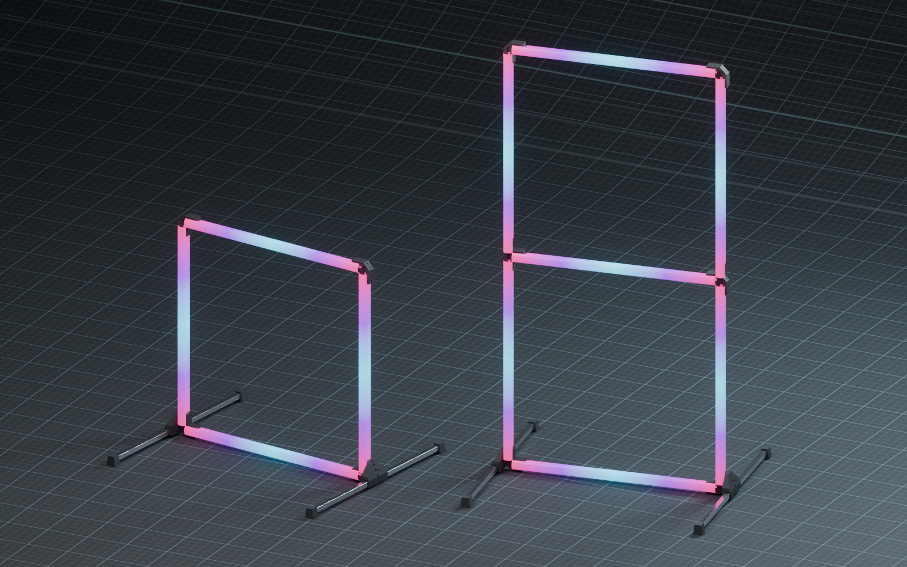

---
hide:
  - toc
---

# Projects

What I am building and researching, from race infrastructure to printer firmware.

  
  

    In development
    <h2><a href="tinywhoop-led-gate/">Modular Tinywhoop LED Gate</a></h2>
    
Square-tube LED gate with printed corners and clip-on diffusers, wireless GateLink control, a simulator, an interactive 3D assembly guide and a 20-gate cost estimate.

    
<a href="tinywhoop-led-gate/">Project page</a> · <a href="tinywhoop-gate/gatelink/">GateLink</a> · <a href="tinywhoop-gate/simulator/">Simulator</a> · <a href="tinywhoop-gate/cost/">Cost</a> · <a href="tinywhoop-gate/log/">Log</a>

  

<h2 class="project-list__title">More projects</h2>

<ul class="project-list">
  <li>
ELECTRONICS · 3D PRINTINGPrototype
<h3><a href="macropad/">MacroPAD</a></h3>
A custom RP2040 macro pad with 25 MX keys, a printed gasket enclosure and space for four scroll wheels. Open the animated 3D preview.
</li>
  <li>
ELECTRONICS · OPEN SOURCEDone
<h3><a href="addressable-balancer-leds/">Addressable Balancer LEDs</a></h3>
Addressable LEDs for battery balancer connectors, with source files and documentation on GitHub.
</li>
  <li>
HDZERO · UNOFFICIAL FIRMWAREReleased
<h3><a href="hdzero-monitor-favorites/">HDZero Monitor Favorites</a></h3>
Eight race-channel favorites, matching scan coverage and a shorter scan trigger for the HDZero Monitor.
</li>
  <li>
3D PRINTING · HARDWARE &amp; FIRMWAREKnowledge base
<h3><a href="3D%20Printing/Flashforge%20Creator%205/Flashforge%20Creator%205/">Flashforge Creator 5</a></h3>
A curated knowledge base covering modifications, firmware architecture and recovery evidence for the Creator 5 family.
</li>
  <li>
ENDURANCE · 1SExperiment
<h3><a href="35-inch-1s-endurance-drone/">3.5&quot; 1S Endurance Drone</a></h3>
An experimental lightweight endurance drone using a 3D-printed PPA-CF frame.
</li>
</ul>
