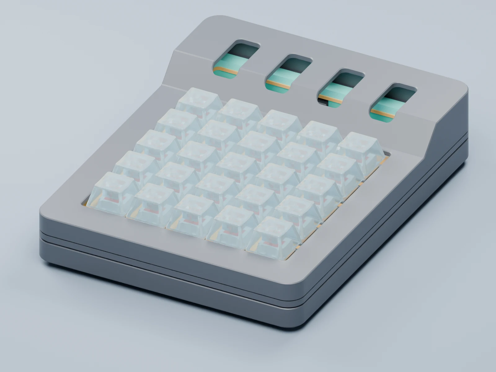

# MacroPAD

*Development preview. This prototype is not a released fabrication package.*

<iframe title="MacroPAD animated CAD preview" src="../../assets/macropad/viewer/index.html" loading="eager"></iframe>

CAD prototype. Drag to rotate, scroll to zoom, or double-click to replay the exploded view. The animation illustrates the layers, not a physical assembly sequence.

A custom RP2040 macro pad with 25 MX keys and a row reserved for four scroll wheels. The enclosure is designed for PETG printing, with a reinforced switch plate supported between two TPU gasket rings. Transparent, unlettered keycaps sit above the low front and side rim.

The parts assemble in the inverted lid, which guides the gaskets and key unit before the bottom closes the case. This is still a fit-test prototype. The scroll-wheel hardware is being selected, so its openings remain empty in the preview.

<noscript></noscript>
