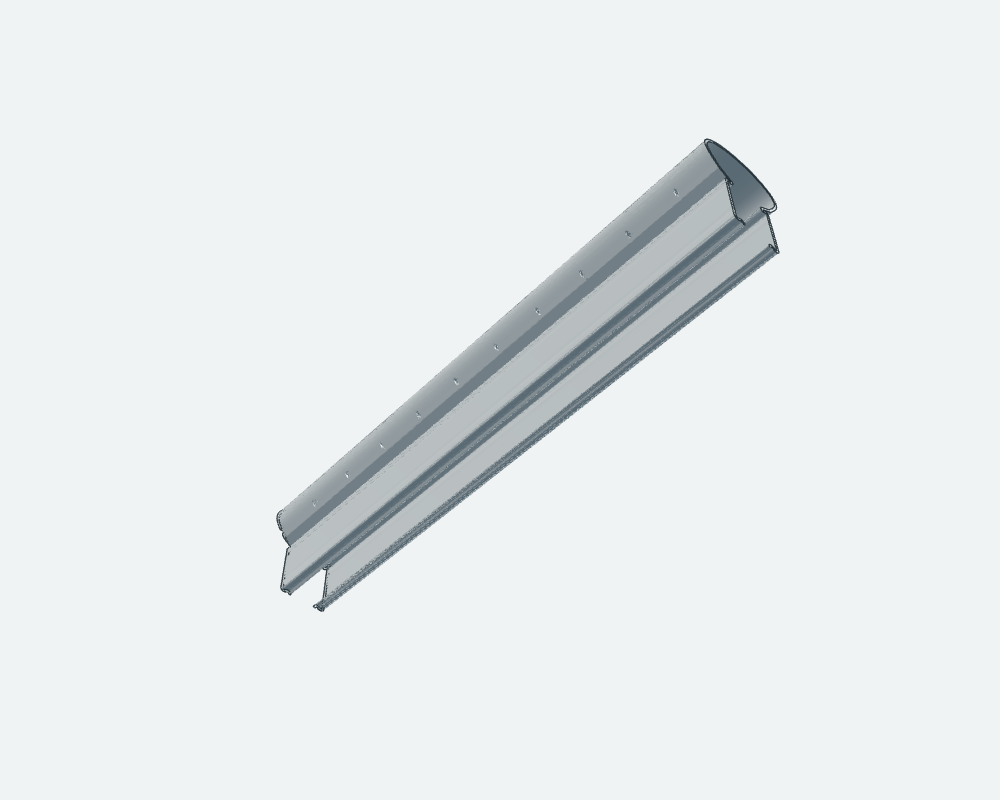
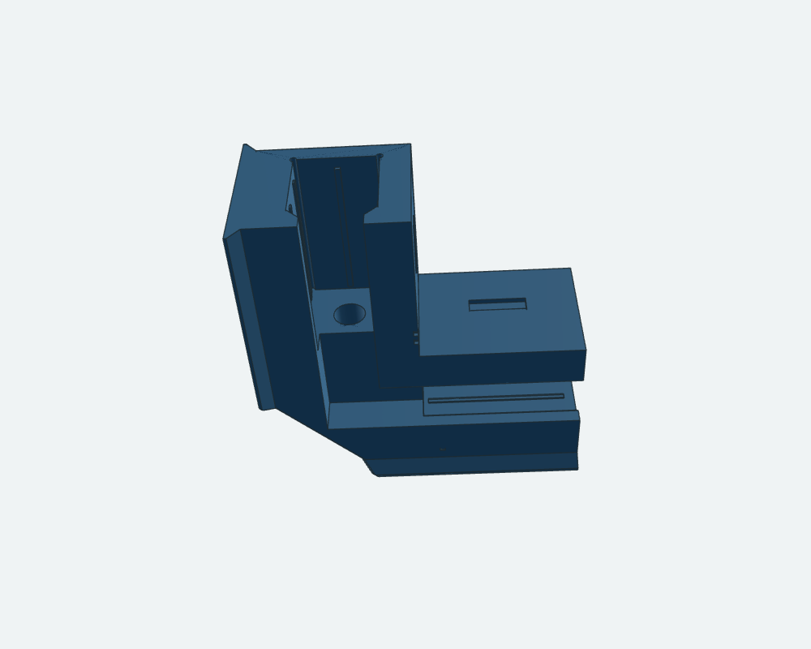
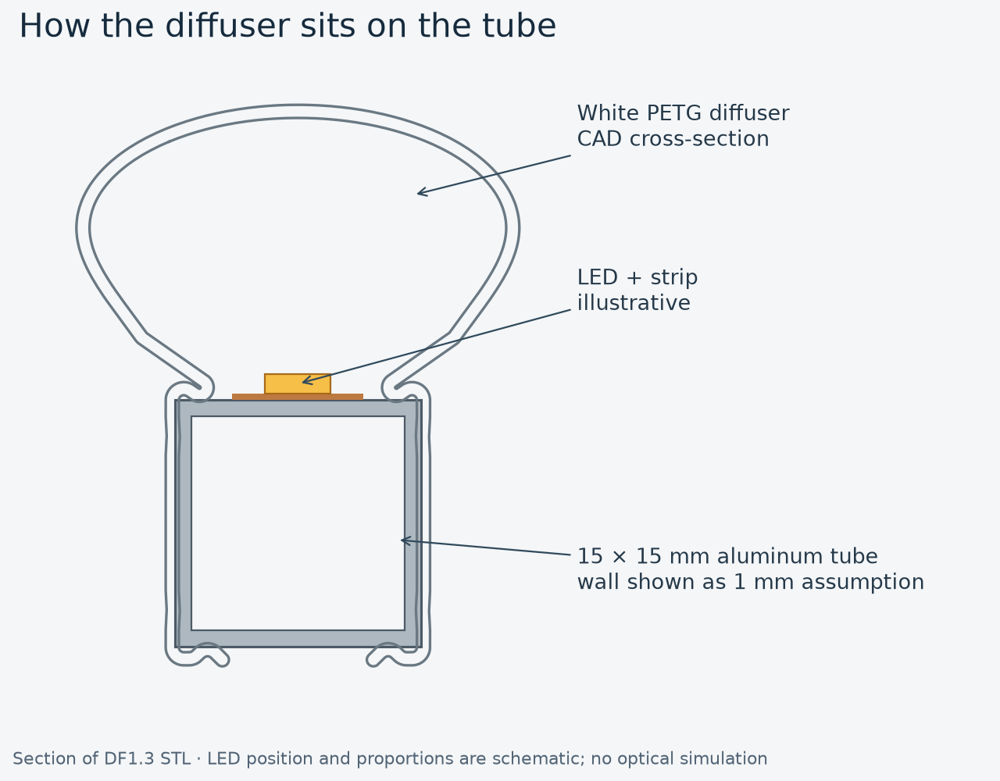
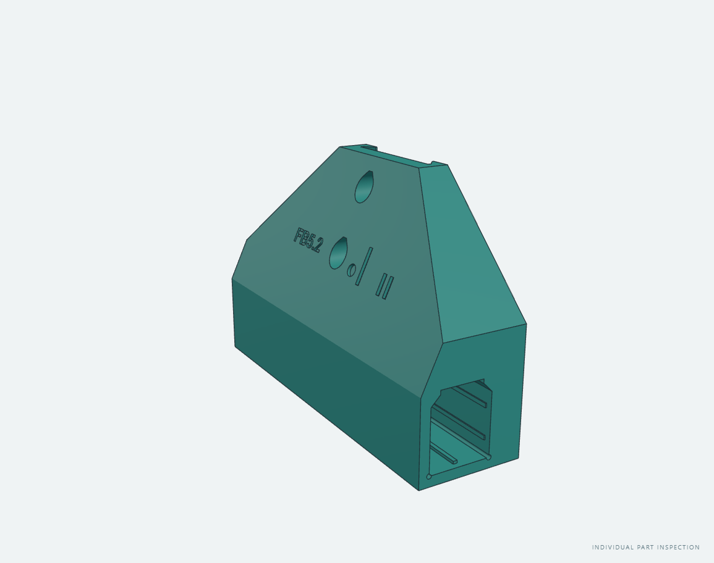
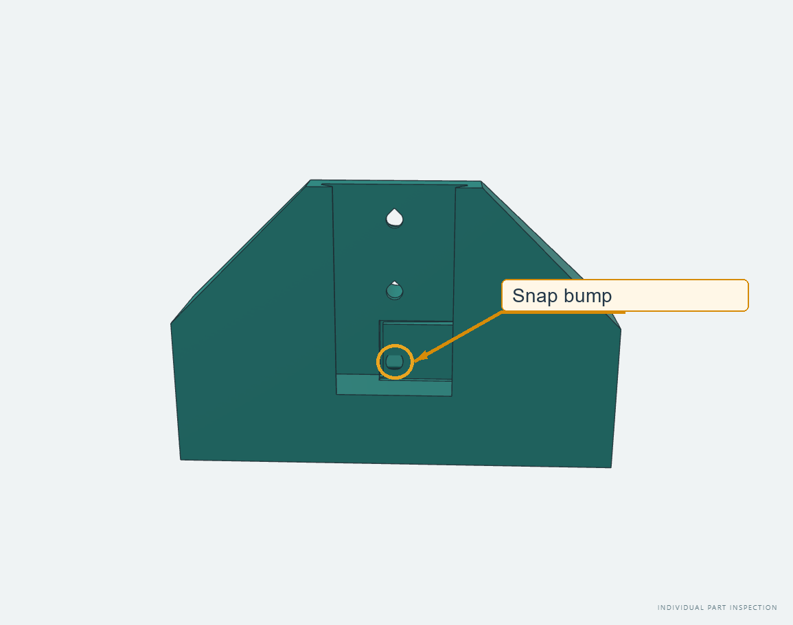

# Diffuser and foot connector concepts

[Project overview](../tinywhoop-led-gate/index.md) · [Project log](log.md)

!!! warning "Local review draft"
    CAD illustrations, not photographs. The v13 diffuser and corner candidates and FB5.2 have not been physically validated. Material appearance is illustrative.

The gate uses 15 × 15 mm aluminum tubes. A white PETG clip-on diffuser forms a chamber over the LED strip; printed connectors join the frame and feet.

## Diffuser and corner parts

*DF1.3 middle segment, v13 candidate.*

*DF1.2 end segment for the cap variant, v13 candidate.*

*CR5.1 corner connector, v13 candidate.*

*DF1.3 STL section with a nominal 15 × 15 mm tube. The 1 mm tube wall, strip and LED are schematic. The undeformed clip intersects the nominal tube at its pinch; printed fit remains to be tested. No optical simulation is shown.*

## FB5.2 foot connector

The corner slides into the foot connector. The candidate spring beam has a bump intended to engage the lowest pilot hole in corner rev4, which must remain without a threaded insert. The 0.3 mm sacrificial print tab must be cut before the beam can flex.

*FB5.2 in the individual-part explorer.*

*FB5.2 from the inner side. The marked bump is intended to engage the corner’s lowest pilot hole. Spring deflection and retention are untested.*

## What remains to be checked

Earlier SQ8W-B clip coupons informed the 0.15 mm-per-side pinch selection. The v13 corner and diffuser variants and FB5.2 need physical tests. Check the diffuser bridge transition, retention, LED clearance and light distribution. The CC1.1 cap is on hold and is not planned for the next print. For FB5.2, check the bridge, tab removal, click, retention, release and repeated use.

The v13 diffuser files are recorded as DF1.1–DF1.4 in the local manifest, but have no physical revision marking. Their identification and compliance with the project revision rule need resolution before relying on printed samples. FB5.2 is available for individual inspection; its retention motion has not been integrated into the full assembly viewer.

For filament evaluation, useful observations include visible layer lines, light transmission and color, bridging, clip retention and repeated installation. No material performance or sponsorship is implied.

*Visuals and draft prepared with substantial OpenAI Codex assistance under project-owner direction.*

