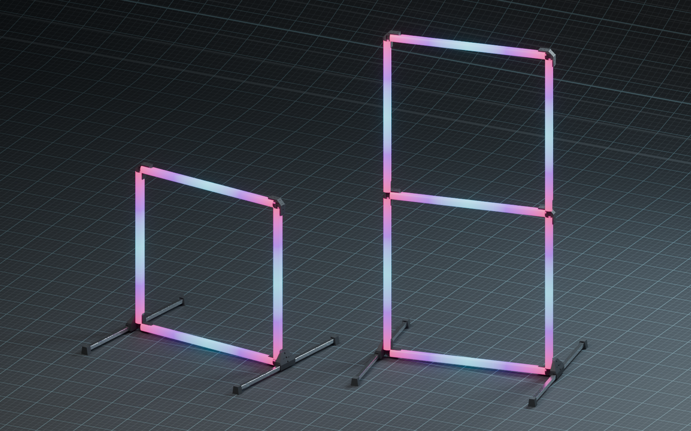

# GateLink: wireless gate control

[Project overview](../tinywhoop-led-gate/index.md) · [Race-event data](race-data.md) · [Project log](log.md)

GateLink connects a PC to LED gate nodes using compact radio messages. A USB gateway and a gate node each use a Seeed XIAO ESP32S3 with Wio-SX1262; the node runs WLED with a GateLink usermod. WLED renders effects locally rather than receiving a stream of individual pixels.

**Control path:** PC → USB gateway → LoRa → gate node → WLED → LEDs.

The node can also return status to the gateway over the radio link.

## Try the simulator

[Open the 3D GateLink simulator in offline mode](../../assets/tinywhoopgate/gatelink-sim/index.html?demo=1). Explore a virtual gate, packet inspector and race-event sequence. The 144-LED layout and selected effects are approximations; the final wiring is undecided.

*CAD illustration of possible RGB effects, not a screenshot of the simulator. The current simulator models one virtual gate.*

## Bench result

On 27 October 2026, 22 end-to-end checks passed with two boards roughly 10 cm apart at 2 dBm. WLED state was read from the node over USB. No LED strip was connected. Range, real LED output, multiple gate nodes, battery operation and authentication remain untested.

The GateLink v1 protocol is an implemented draft: commands select state, colours or events, and nodes can send status. Authentication is reserved, not implemented. The [race-event snapshot](race-data.md) is a separate data format; a live bridge is a future idea.
