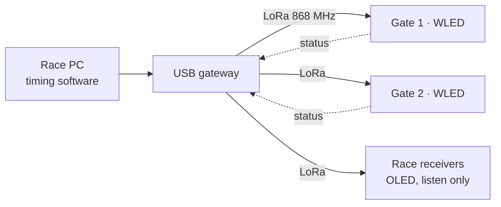
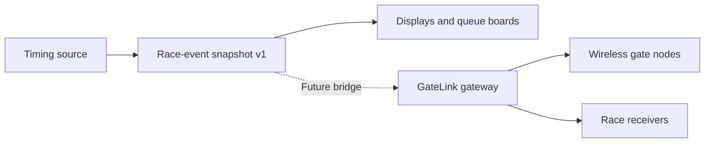
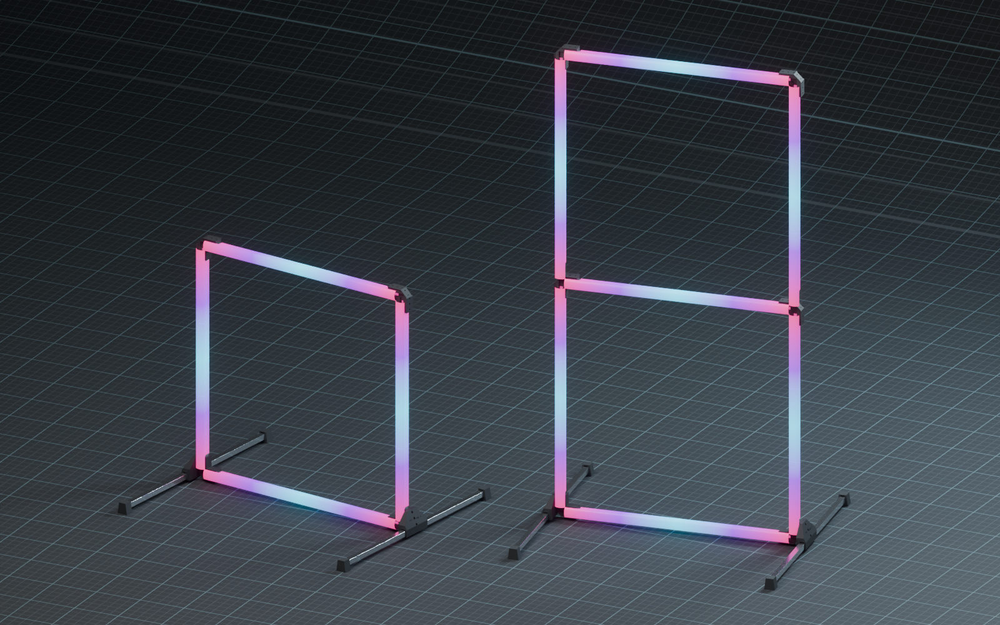

# GateLink: wireless gate control

[Project overview](../tinywhoop-led-gate/index.md) · [GateLink simulator](simulator.md) · [Project log](log.md)

GateLink sends the state of a race to every gate over one quiet radio link. A USB gateway at the race PC sends short LoRa messages; each gate node runs WLED and decides by itself how its LEDs show that state. The same messages could also drive small receivers with a display, so pilots in the pits always see who flies now and who is next.

**Control path:** race PC → USB gateway → LoRa → gate nodes (WLED) → LEDs.

!!! tip "See it working"
    The [GateLink simulator](simulator.md) runs a whole event in your browser: track, heats, laps and every radio frame byte by byte. No hardware needed.

## Why LoRa, and why below 1 GHz

At an FPV race, 2.4 GHz and 5 GHz are full. Every pilot's radio link sits on 2.4 GHz (ExpressLRS, Ghost, Tracer and others), every video transmitter on 5.8 GHz, and 2.4/5 GHz Wi-Fi and Bluetooth share the same spectrum. With dozens of quads, goggles, phones and timing gear switched on, Wi-Fi between gates often barely reaches a couple of metres. Gates that need Wi-Fi to know the race has started fail exactly when they matter.

GateLink therefore moves down to the sub-GHz band: **868 MHz in Europe** (915 MHz is the North American counterpart, not implemented yet). Few race pilots fly sub-GHz control links today, so the band is quiet at a race. The longer wavelength gets around people, tents and gate frames better, and LoRa can decode signals that are weaker than the background noise.

Some pilots still use sub-GHz links, such as ExpressLRS 868/915 MHz or TBS Crossfire, mainly for long range. GateLink keeps its footprint small so it does not get in their way or in the way of the race:

| Rule | What GateLink does |
| --- | --- |
| One fixed channel | 869.525 MHz in the EU sub-band 869.40–869.65 MHz (10 % duty cycle, up to 500 mW ERP; check your national rules) |
| Short frames | LoRa SF7, 250 kHz; a message is 10–54 bytes and stays on air for 21–51 ms |
| States, not streams | it sends "race running" or "pilot 3 completed a lap", never pixel data; the gate renders the effect itself |
| Low power | 2 dBm on the bench; up to 22 dBm if a large venue needs it |
| Hard duty-cycle limit | the gateway counts every millisecond on air and delays a frame rather than exceed the limit |

A full event uses about 1–2 % of the airtime, well below the 10 % the band allows. A sub-GHz control link that hops across 863–870 MHz can still meet a GateLink frame for a moment; GateLink repeats important frames and every command is a complete state, so a lost frame is repaired by the next one. Range and coexistence with a real sub-GHz control link next to the gates have not been tested yet.

## What travels over the air

The gateway does not tell a gate which LEDs to light. It tells all gates what is happening in the race; each gate looks up its own effect. Before an event, each gate receives its configuration once: which WLED preset belongs to which race state, and which animation plays for a lap, holeshot, best lap or finish. During the race only short state and event messages follow.

| Race moment | Message | Content | Size | On air |
| --- | --- | --- | --- | --- |
| Clock for all gates | `BEACON` every 2 s | gateway time, so effects and the countdown start on the same millisecond on every gate | 16 B | 26 ms |
| Who flies now and next | `HEAT_LINEUP` | round, heat, up to 8 × (pilot, video channel, colour); current, next and after-next heat | 34 B (4 pilots) | 39 ms |
| Pilot names | `PILOT_INFO` | pilot number, colour, name up to 16 characters | 25 B | 31 ms |
| "Heat 4 to the line" | `BROADCAST` | kind (info, call pilots, warning), duration, colour, text up to 32 characters | 36 B | 39 ms |
| Race state | `RACE_STATE` | idle, staging, countdown, running, paused, finished, aborted; for the countdown the exact start time | 17 B | 26 ms |
| Lap, holeshot, best lap, finish, DNF | `RACE_EVENT` | event, pilot, lap, lap time | 16 B | 26 ms |
| Show this look | `PRESET` | WLED preset number | 10 B | 21 ms |

Each frame starts with a 9-byte header: protocol version, network id (gates of another GateLink network ignore the frame), sender, destination (one gate, a group of gates or all), sequence number and message type. New fields go into optional tagged extensions, so older gates keep working when the protocol grows. The full specification lives in the GateLink repository (`docs/PROTOCOL.md`).

**Airtime of one heat**, 4 pilots, 3 laps, every broadcast sent three times for safety: line-ups for the current and next heat, four pilot names, the call to the line, staging, countdown and finish, and about 20 lap and holeshot events add up to roughly 2.5 seconds on air. With the clock beacon, a busy event stays at about 2–3 % of the time.

### Race-event data from the timing software { #race-event-data }

Race software can expose an event snapshot with races, pilots, channels and freshness information. LiveTimeQue defines a versioned JSON format for consumers such as displays and queue boards. A bridge would read that snapshot and turn changes into the compact GateLink messages above.

The bridge is a proposed direction, not a demonstrated live integration. Today the race messages come from the GateLink simulator or from the gateway command line.

## Race receivers for every pilot (idea)

Because the race state is broadcast anyway, anyone can listen to it. A pocket receiver from an ESP32 board with an SX1262 LoRa radio and a small OLED, such as the boards sold for Meshtastic, costs around 15–20 € and could show the current and next heat at all times:

HEAT 4 · RUNNING   1:12NOW  R1 Kidce     R2 Mila
     F4 Jonas     R7 Ari
NEXT L6 Tom       R8 Sven
     F2 Lena      R1 Max

*Mock-up of a 128 × 64 pixel display, not a built device.*

- **Listen only:** a receiver never transmits, so a hundred receivers add no airtime and do not disturb anything.
- **Data already exists:** line-ups for the current, next and after-next heat, pilot names and colours, the race state with the exact countdown, and broadcast texts such as "Heat 4 to the line" are all part of GateLink v1.
- **Useful at large events:** at championships with long schedules and pilots spread over a hall or field, everyone sees when to get ready without walking to the screen.

No receiver firmware exists yet.

## Bench result

On 27 October 2026, 22 end-to-end checks passed with two boards roughly 10 cm apart at 2 dBm. WLED state was read from the node over USB. No LED strip was connected. A simulated event of 2 heats × 4 pilots then ran over the real radio with all acknowledgements received. Range, real LED output, multiple gate nodes, battery operation and authentication remain untested.

Hardware today: a Seeed XIAO ESP32-S3 with Wio-SX1262 as USB gateway and the same pair in each gate. The GateLink v1 protocol is an implemented draft; authentication is reserved, not implemented.

## Try the simulator

[Open the 3D GateLink simulator](simulator.md) (always the current GateLink code). Build a small track, run an event with heats and laps, and watch the packet inspector. In the **Presets** tab you can build a gate's WLED presets with built-in symmetry (corners to rail centres, centres to corners, waterfall, fountain), map race states and race events to them, export a standard `presets.json`, and send the whole configuration to a gate over the radio link. On hardware this needs GateLink usermod build 8, which is not flashed yet.

*CAD illustration of possible RGB effects, not a screenshot of the simulator. The 144-LED layout and selected effects are approximations; the final wiring is undecided.*
