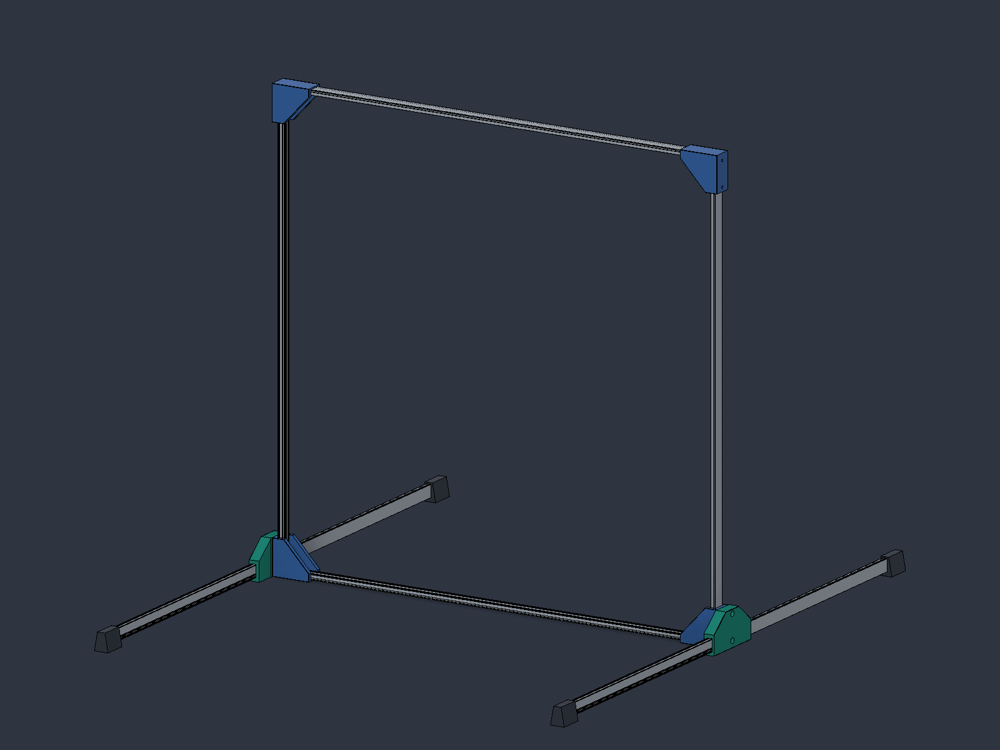
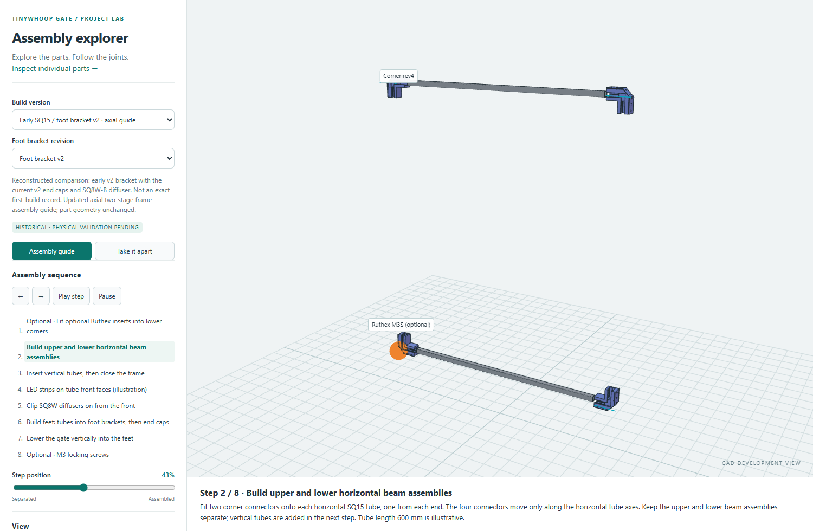

# Project log

[Project overview](../tinywhoop-led-gate/index.md) · [Earlier concepts](archive.md) · [GateLink](gatelink.md)

## Early October · profile experiments

Two orientations of a shallow U-profile gate were physically tried; the rails twisted too easily. A V-profile design was then studied in CAD. The [archive](archive.md) contains the earlier galleries.

*CAD depiction of the U-profile concept.*

## October · square tubes and printed parts

The project moved to 15 × 15 mm square tube. Corners, feet and clip-on diffuser variants were developed alongside fit coupons. Dimensions, inventory and physical test results still need reconciliation.

*Early CAD diffuser study.*

## 24–26 October · assembly exploration

An interactive guide and part explorer were built to examine the assembly sequence and revisions. CAD motion is illustrative; physical retention, stability and lighting need testing.

*Staged horizontal beam assembly in the local viewer.*

## 27 October · wireless control and cost update

GateLink firmware, a simulator and a two-board bench test were documented. The bench test passed 22 checks without an LED strip. A new observed LED reel price was used in the [cost estimate](cost.md), subject to delivered-price verification.
