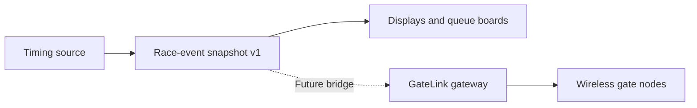

# Race-event data and gate events

[Project overview](../tinywhoop-led-gate/index.md) · [GateLink](gatelink.md) · [Project log](log.md)

Race software can expose an event snapshot with races, pilots, channels and freshness information. LiveTimeQue defines a versioned JSON format for consumers such as displays and queue boards. GateLink separately defines compact wireless commands for gate nodes.

A bridge from race data to gate lighting is a proposed direction, not a demonstrated live integration. The GateLink simulator can illustrate a sequence of race messages with a virtual node; it does not prove a connection to a timing system.

[Explore the simulator](../../assets/tinywhoopgate/gatelink-sim/index.html) · [Wireless control](gatelink.md)
