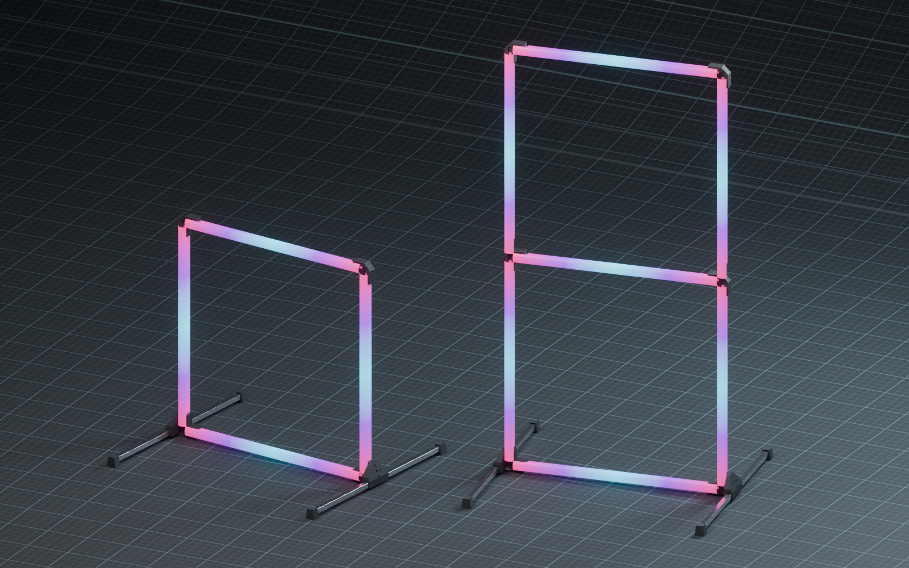
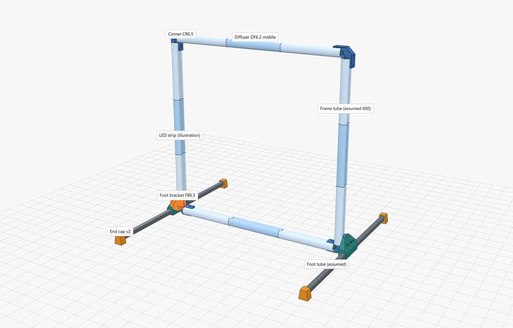

---
article:
  published: 2026-10-02
  updated: 2026-11-03
  summary: Modular LED race gate for Tinywhoops from 15 x 15 mm aluminum tubes and printed parts, with an interactive 3D assembly guide and a cost estimate for 20 gates.
  image: assets/images/projects/tinywhoop-led-gate/gate-single-double-rgb-metal.png
  image_alt: Blender render of a single and conceptual stacked double LED gate
  changes:
    - date: 2026-11-03
      summary: The assembly and part explorers now show corner CR6.5 and foot bracket FB6.3 with the 60° zero-play snap catch, plus the printed CR6.4 and FB6.2 pair. Test coupons are no longer listed in the part explorer.
    - date: 2026-10-31
      summary: The assembly and part explorers now show the newest CAD revisions, corner CR5.1, foot bracket FB5.2 with a snap clip and the DF6 diffuser rail set, with their STL/STEP print files.
    - date: 2026-10-27
      summary: Restructured around the current square-tube design with project status, interactive assembly guide and a 20-gate cost estimate; earlier U and V concepts moved to the archive.
title: Modular Tinywhoop LED Gate
hide:
  - toc
description: Modular LED race gate for Tinywhoops from 15 x 15 mm aluminum tubes, printed corners and clip-on diffusers.
---

# Modular Tinywhoop LED Gate

<figure class="tg-hero">
  
  <figcaption>Blender render based on the CAD assembly · The RGB effect and double-gate junction are illustrative; dimensions and fit remain to be validated.</figcaption>
</figure>

A modular Tinywhoop racing gate made from aluminum tubes and printed parts. Around the frame, the project explores wireless LED control with GateLink, race-event integration and interactive 3D assembly tools.

[Explore the assembly](#assembly-explorer) · [Discover GateLink](../tinywhoop-gate/gatelink.md)

## Current status · 27 October 2026

This is the previously published status snapshot. Physical inventory and test evidence are being reconciled; the full illuminated single and double gate still need validation.

| Part | Current version | Status |
| --- | --- | --- |
| Frame | 15 × 15 × 1 mm aluminum tube, 600 mm | Gate size not final |
| Corners | Printed 90° corner rev4 | Tube sockets fit; frame stands without screws |
| Diffuser | Clip-on SQ8W segments, 0.15 mm pinch per side | Clip fit chosen from printed test pieces |
| Feet | Foot bracket FB3.1, end cap v2, 250 mm legs | End cap fit OK; bracket and leg length still open |
| LEDs | WS2812B strip, 60 LEDs/m | Soldered across the corners; no plug connectors for now |

Not tested yet: a complete gate with lighting, its stability and the final leg length. All images on this page are CAD views.

## One project, several connected pieces

The gate combines a mechanical frame, lighting and a wireless control concept. A USB gateway sends short GateLink radio commands to a gate node; the node runs WLED and produces LED effects locally. Race-event data could feed the gateway through a future bridge.

**[GateLink and wireless nodes](../tinywhoop-gate/gatelink.md) · [Race-event data](../tinywhoop-gate/race-data.md) · [Project log](../tinywhoop-gate/log.md) · [Cost estimate](../tinywhoop-gate/cost.md) · [Earlier concepts](../tinywhoop-gate/archive.md)**

[Open the interactive GateLink simulator](../../assets/tinywhoopgate/gatelink-sim/index.html): choose Offline to explore the virtual gate, lighting and packet flow. LED effects and wiring are approximations, not a physical LED test.

## Assembly explorer

<button class="md-button md-button--primary" id="tg-open-assembly" type="button">Assembly guide</button>
<button class="md-button" id="tg-open-parts" type="button">Individual parts</button>

Starts with the newest CAD parts: corner CR6.5, foot bracket FB6.3 and DF6 diffusers. The 3D viewer loads about 4 MB.

<a href="../../assets/tinywhoopgate/viewer/index.html#build=sq15-v05-cr65-fb63-axial">Open the large viewer</a> · <a href="../../assets/tinywhoopgate/viewer/TinywhoopGate-viewer-offline.zip" download>Offline package (26 MB)</a>

<noscript>The interactive viewer needs JavaScript. <a href="../../assets/tinywhoopgate/viewer/TinywhoopGate-viewer-offline.zip">Download the offline package</a>.</noscript>

- **Assembly guide:** eight steps; the camera moves to each joint. M3 screws and inserts are optional.
- **Take it apart:** drag the orange handle of a joint or use the slider.
- **Individual parts:** each revision on its own, with its counterpart and the original STL/STEP print files.

The default build shows the current corner CR6.5 and foot bracket FB6.3: a clip bump with a 60° retention flank catches in a pocket in each corner tail, with zero vertical play. This pair is not printed yet; the 60° catch was tested only on small test pieces. The predecessor pair CR6.4 + FB6.2 (55° catch) was printed and fits, but holds more softly; it is selectable under Build version as the printed pair. The DF6 diffusers are not fit-tested yet. Older builds, including CR5.1 + FB5.2, the FB3.1 reference and the FB4.1 latch experiment, stay selectable. Frame and leg lengths in the model are placeholders.

Design and documentation prepared with substantial OpenAI Codex and Claude assistance under the project owner’s direction.

[Local review draft: diffuser and FB5.2 images](../tinywhoop-gate/diffuser-foot-review.md)

